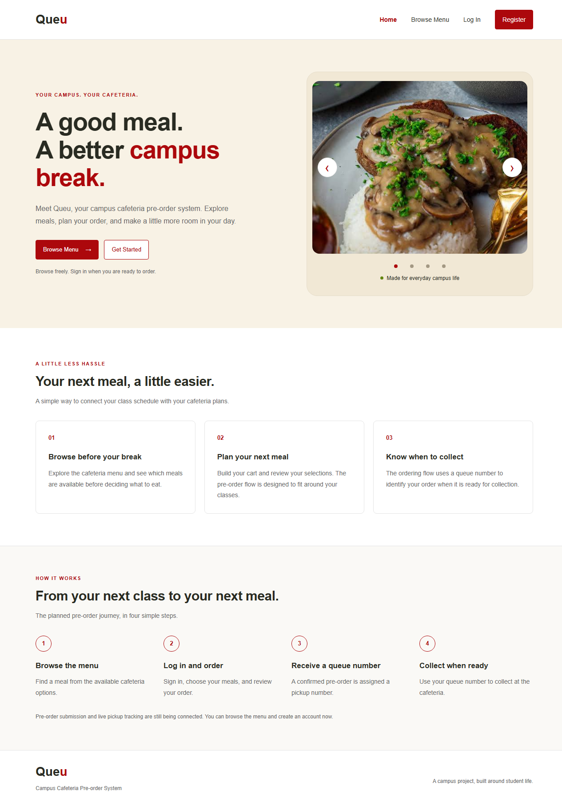
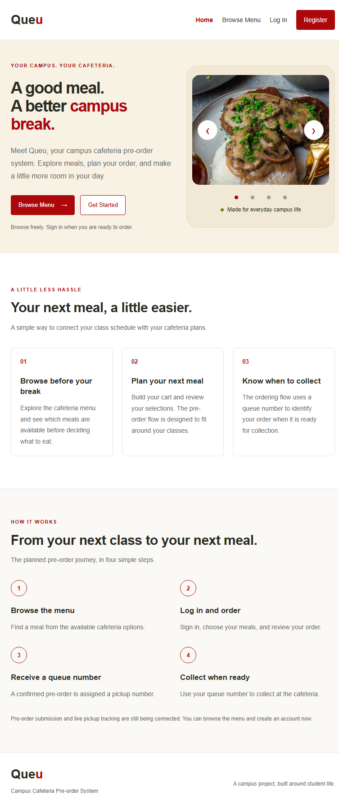
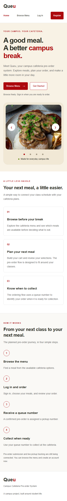

# Public landing page — Issue #45

Run `npm run dev` from `frontend`, then open the URL printed by Vite at `/`.
The landing page loads without a login, backend server, database, or order/queue API.

## Implementation

- `src/pages/LandingPage.jsx`: public navigation, hero, three benefits, four-step
  workflow, and project footer. Repeated cards use arrays and `map`.
- `src/pages/LandingPage.css`: scoped styles using the existing colors, Arial,
  shared button classes, Flexbox, Grid, and media queries. No `:root` variables.
- `src/components/landing/MealCarousel.jsx`: displays four user-provided local
  meal photos with touch swipe, mouse drag, previous/next arrows, slide dots, and
  left/right keyboard controls. It uses `useState` and `useRef`, with no new library.
  The photos are hero visuals, not menu or availability records.
- `src/App.jsx`: maps `/` to the landing page and makes `/menu` public using the
  existing navigation approach. React Router is not installed or added.
- `CafeteriaLayout.jsx`: includes Home and displays Log in for public visitors.
- Existing login/register brand links return to `/`.

## Navigation

| Route | Behavior |
| --- | --- |
| `/` | Public landing page; no API calls |
| `/menu` | Public menu; uses the existing real `GET /api/menu` endpoint |
| `/login` | Existing login screen |
| `/register` | Existing registration screen |
| `/cart`, `/checkout`, `/orders` | Continue to require a login token |

Browse Menu opens `/menu`. Guests who click Add to cart are taken to `/login`;
authenticated users retain the existing cart behavior. This is frontend navigation,
not a substitute for backend authentication or authorization.

The workflow describes the intended pre-order journey. It explicitly notes that
submission and live tracking are still being connected. This task does not change
authentication, checkout submission, queue generation, APIs, or database behavior.

## Validation

- `npm run lint`: passed.
- `npm run build`: passed.
- Production-build browser checks passed at 1280×900, 768×1024, 390×844, and
  320×700: no horizontal overflow; all four photos loaded; all sections rendered.
- Carousel arrows, first/last wraparound, dots, keyboard controls, mouse drag, and
  real touch swipe passed browser checks. Reduced-motion preference removes the
  slide transition. Slides change manually; there is no automatic timer.
- Landing made zero API requests. No order/queue calls or order submissions were
  made during the browser checks.
- Home, Browse Menu, Log In, Register, Get Started, account brand links, and
  browser Back worked. Direct menu/login/register routes also rendered.
- A guest could browse the menu and was directed to login when adding a meal.
  Direct guest access to the cart remained protected. Authenticated cart additions
  still worked.
- No JavaScript runtime exceptions occurred.

Menu/auth responses were intercepted with browser-test fixtures for navigation
checks only. The application contains no fake menu-data fallback. Live login and
menu loading still depend on the existing backend and local database setup.

To repeat manually, start the frontend, open `/` with the backend stopped, and
check the landing layout at the sizes above. Start the backend to check real menu
loading. Follow the navigation links and verify that protected routes still require
login.

## Screenshots

### Desktop

### Tablet

### Mobile

