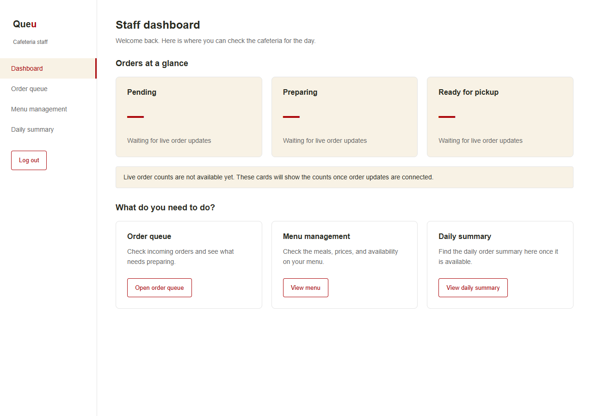
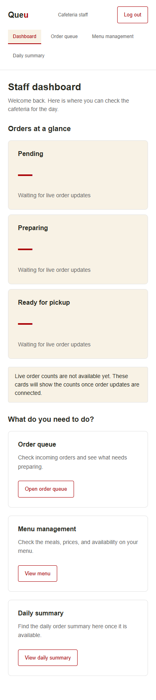

# Cafeteria staff dashboard

Implements the frontend navigation and dashboard for [Issue #54](https://github.com/GONG4o4/campus-cafeteria-system/issues/54).

The staff pages use the existing red, cream, and white design, shared buttons, alerts, loading messages, and sidebar styles. New staff layouts use Flexbox and media queries. They do not use `:root`, `grid-template-columns`, or `min()` and `calc()` for widths.

## Pages

| Path | Purpose |
| --- | --- |
| `/staff` | Staff dashboard with today's pending, preparing, and ready counts, the Sales insights section, and navigation links. |
| `/staff/dashboard` | Alternate dashboard URL. |
| `/staff/orders` | Staff order queue (`GET /api/staff/orders`) with status updates and no-show handling. |
| `/staff/menu` | Menu management using the existing menu API, with add/edit forms, availability controls, loading, empty, error, retry, and refresh states. |
| `/staff/summary` | Sales statistics page (`GET /api/staff/stats`) with daily, weekly, monthly, and yearly sales, trends, and top orders. |

The menu destination has been extended by [Issue #57](staff-menu-management.md) to support adding and editing meals and changing availability. It does not offer deletion controls.

## Login and access

Successful login sends `cafeteria_staff` accounts to `/staff`. Student accounts keep the existing menu flow. The general `staff` role is separate from `cafeteria_staff` in the current backend and does not receive cafeteria dashboard access.

Opening or refreshing a protected page checks the token using the existing `GET /api/test/protected` endpoint. The returned user ID and role determine access; changing the stored `user` object does not grant staff access. Students opening staff URLs are redirected to `/menu`. Guests and expired sessions return to `/login`.

Logout clears the token, stored account, cart, confirmed order, and in-memory session before returning to the shared login page. Browser back navigation does not restore the staff dashboard after logout.

## Dashboard data

The count cards use `GET /api/staff/orders`, which returns paid orders only. The dashboard shows today's (Asia/Manila) pending, preparing, and ready counts and refreshes them every 10 seconds. If the request fails, an error alert replaces the "Showing cafeteria orders" note.

## Opening the dashboard

Start the backend with `npm start` in `backend`, then run `npm run dev` in `frontend`. Sign in with an existing `cafeteria_staff` account to reach `/staff`. Registration creates student accounts and does not grant cafeteria staff access.

## Validation (Issue #54, historical)

These checks were recorded when the dashboard was first built. The automated test files and `npm test` scripts were later removed (PR #91), so the test counts below cannot be re-run from the current repository.

- Frontend ESLint and production build passed.
- All 86 backend regression tests and 12 frontend tests passed after the menu management work.
- Hidden Chrome checks used the production build with isolated in-memory API fixtures and the real Express login routes, bcrypt, JWT signing, and authentication middleware. No real database was queried or changed by these browser tests.
- Cafeteria staff login, protected page refresh, sidebar and dashboard links, browser back navigation, logout, expired tokens, session connection failures, and role redirects passed.
- Student and general staff accounts were denied all staff routes, including when the stored profile was changed to claim `cafeteria_staff`.
- Menu loading, available/unavailable meals, empty menu, server errors, connection errors, retries, and refresh passed.
- Student menu, add-to-cart, cart, checkout navigation, and order history continued to work.
- Layout checks passed at 1280px, 768px, 390px, and 320px without horizontal overflow or uncaught JavaScript errors.

## Screenshots

The screenshots were taken for Issue #54, before live counts and Sales insights were added, so they show the earlier unavailable state for order counts.





## Sales insights (Issue #67)

Implements [Issue #67](https://github.com/GONG4o4/campus-cafeteria-system/issues/67). The staff dashboard has a **Sales insights** section below the live status counts. It is a custom date range view and works alongside the Sales statistics page (`/staff/summary`, `GET /api/staff/stats`), which shows fixed daily, weekly, monthly, and yearly periods.

Backend route: `backend/routes/staffAnalytics.js`

```
GET /api/staff/analytics?startDate=YYYY-MM-DD&endDate=YYYY-MM-DD
```

- Needs a valid token with the `cafeteria_staff` role. No token or an invalid token returns `401`; any other role returns `403`.
- `startDate` defaults to today in Asia/Manila. `endDate` defaults to `startDate`. Both dates are included.
- Dates must be real calendar dates in `YYYY-MM-DD` format. Wrong formats, impossible dates such as `2026-02-30`, repeated parameters, and a start date after the end date return `400`.
- All totals are calculated in PostgreSQL with parameterized queries. The frontend only displays them.
- No database migration is needed. The route reads `orders`, `order_items`, `menu_items`, and `payments`.

### Calculation rules

Only **paid** orders are counted. Every query uses a paid-payment filter (`EXISTS` a `payments` row for the order with status `paid`), the same rule the staff order queue uses. Checkouts that were never paid, and older orders with no payment row, are not counted.

> **Figures can differ from the Sales statistics page.** The Sales statistics page (`GET /api/staff/stats`, `backend/services/salesStats.js`) does not use a payment filter at the moment. It counts every order that is not `cancelled`, including unpaid ones. For the same dates, its order counts and sales can therefore be higher than Sales insights.

| Metric | Rule |
| --- | --- |
| Order value | Sum of `orders.total_amount` for paid orders that are not `cancelled`. Paid orders marked `no_show` are included. |
| Total orders | Every paid order in the range, including cancelled ones. |
| Cancelled orders | Paid orders with status `cancelled`. |
| Average order value | Order value ÷ number of paid, non-cancelled orders. Returns `0.00` when there are none. |
| Top 5 dishes | Ranked by `SUM(order_items.quantity)` from paid, non-cancelled orders. Ties are sorted by name. Also shows the number of orders and the order value for each dish. |
| Orders by status | All six statuses (`pending`, `preparing`, `ready`, `picked_up`, `cancelled`, `no_show`), with `0` for any status that has no orders. The counts add up to total orders. |
| Orders by hour | All paid orders, grouped by the Asia/Manila hour of `ordered_at`. Only hours with orders are listed. |

- The date filter uses `orders.order_date`, the same Asia/Manila business date the queue system uses.
- Order totals are read from the `orders` table only, so orders with many items are not counted twice. Item quantities come from a separate query.
- `ordered_at` is stored without a time zone in the database session's time zone, so it is converted to Asia/Manila before taking the hour.

### Frontend

- `frontend/src/analyticsApi.js` sends the request with the saved token and checks that the response has `period`, `summary`, `ordersByStatus`, `topDishes`, and `ordersByHour`.
- `frontend/src/components/StaffAnalytics.jsx` shows start and end date pickers (latest allowed date is today), a **Today** button, four summary cards, and panels for top dishes, orders by status, and orders by hour.
- A loading message is shown on the first load. Later loads keep the previous results on screen with "(updating...)".
- A start date after the end date shows a message and does not send a request. Request errors are shown in an error alert.
- A range with no paid orders shows "No orders for this period".

### Refresh behavior

The pending, preparing, and ready counts still refresh every 10 seconds. Sales insights load when the dates change or when **Refresh dashboard** is pressed, not on the 10-second timer.

### Validation

There is no automated test suite in the repository at the moment: the test files and `npm test` scripts were removed in PR #91, and no `staffAnalytics.test.js` exists. This feature needs to be checked by hand against a development database before release.
