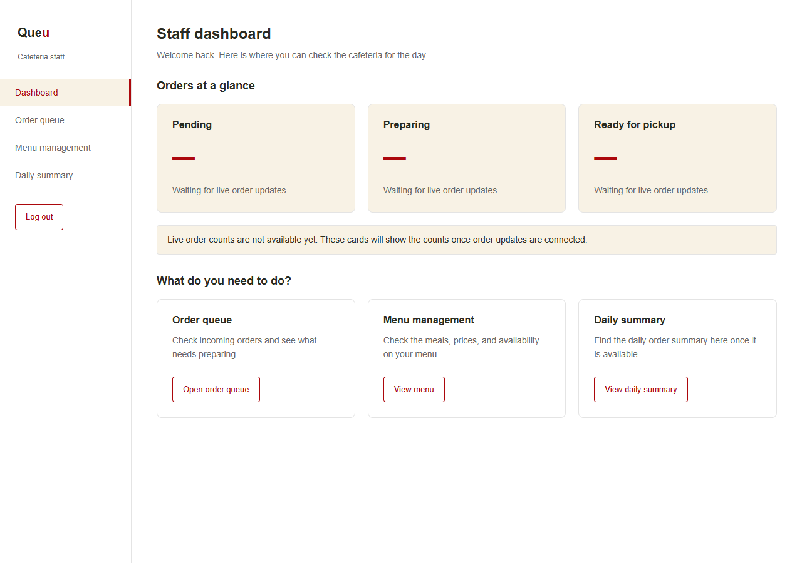
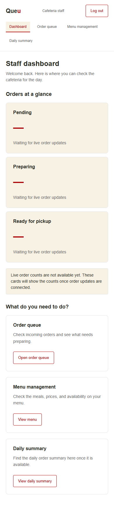

# Cafeteria staff dashboard

Implements the frontend navigation and dashboard for [Issue #54](https://github.com/GONG4o4/campus-cafeteria-system/issues/54).

The staff pages use the existing red, cream, and white design, shared buttons, alerts, loading messages, and sidebar styles. New staff layouts use Flexbox and media queries. They do not use `:root`, `grid-template-columns`, or `min()` and `calc()` for widths.

## Pages

| Path | Purpose |
| --- | --- |
| `/staff` | Staff dashboard with pending, preparing, and ready count cards and navigation links. |
| `/staff/dashboard` | Alternate dashboard URL. |
| `/staff/orders` | Order queue destination with a clear unavailable message until a staff queue API exists. |
| `/staff/menu` | Menu management using the existing menu API, with add/edit forms, availability controls, loading, empty, error, retry, and refresh states. |
| `/staff/summary` | Daily summary placeholder. |

The menu destination has been extended by [Issue #57](staff-menu-management.md) to support adding and editing meals and changing availability. It does not offer deletion controls.

## Login and access

Successful login sends `cafeteria_staff` accounts to `/staff`. Student accounts keep the existing menu flow. The general `staff` role is separate from `cafeteria_staff` in the current backend and does not receive cafeteria dashboard access.

Opening or refreshing a protected page checks the token using the existing `GET /api/test/protected` endpoint. The returned user ID and role determine access; changing the stored `user` object does not grant staff access. Students opening staff URLs are redirected to `/menu`. Guests and expired sessions return to `/login`.

Logout clears the token, stored account, cart, confirmed order, and in-memory session before returning to the shared login page. Browser back navigation does not restore the staff dashboard after logout.

## Existing API limits

The current backend has student order creation and history endpoints. It does not provide a cafeteria staff queue, dashboard counts, or daily summary endpoint. This change does not query the student's private order history for staff totals or add backend routes.

Count cards show an em dash with an unavailable label instead of inventing zero orders. The queue explains that incoming orders are not available; this is distinct from a verified empty queue. Live counts, a real empty-queue state, and daily totals require the relevant staff API before they can be completed and tested.

No backend source, database, or local environment configuration was changed for this task.

## Opening the dashboard

Start the backend with `npm start` in `backend`, then run `npm run dev` in `frontend`. Sign in with an existing `cafeteria_staff` account to reach `/staff`. Registration creates student accounts and does not grant cafeteria staff access.

## Validation

- Frontend ESLint and production build passed.
- All 86 backend regression tests and 12 frontend tests passed after the menu management work.
- Hidden Chrome checks used the production build with isolated in-memory API fixtures and the real Express login routes, bcrypt, JWT signing, and authentication middleware. No real database was queried or changed by these browser tests.
- Cafeteria staff login, protected page refresh, sidebar and dashboard links, browser back navigation, logout, expired tokens, session connection failures, and role redirects passed.
- Student and general staff accounts were denied all staff routes, including when the stored profile was changed to claim `cafeteria_staff`.
- Menu loading, available/unavailable meals, empty menu, server errors, connection errors, retries, and refresh passed.
- Student menu, add-to-cart, cart, checkout navigation, and order history continued to work.
- Layout checks passed at 1280px, 768px, 390px, and 320px without horizontal overflow or uncaught JavaScript errors.

## Screenshots

The screenshots show the actual dashboard layout, including the honest unavailable state for order counts.

