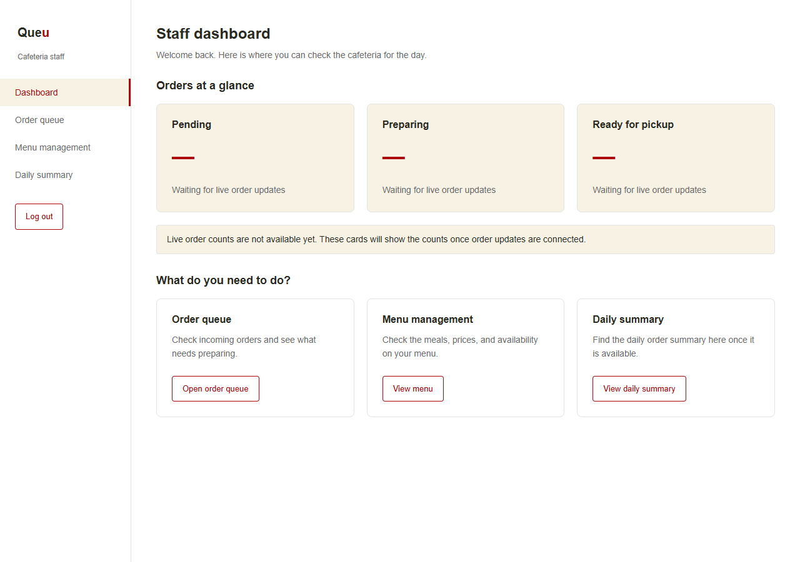
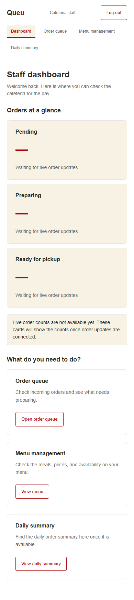

# Cafeteria staff dashboard

Implements the frontend navigation and dashboard for [Issue #54](https://github.com/GONG4o4/campus-cafeteria-system/issues/54).

The staff pages use the existing red, cream, and white design, shared buttons, alerts, loading messages, and sidebar styles. New staff layouts use Flexbox and media queries. They do not use `:root`, `grid-template-columns`, or `min()` and `calc()` for widths.

## Pages

| Path | Purpose |
| --- | --- |
| `/staff` | Staff dashboard with pending, preparing, and ready count cards and navigation links. |
| `/staff/dashboard` | Alternate dashboard URL. |
| `/staff/orders` | Order queue destination with a clear unavailable message until a staff queue API exists. |
| `/staff/menu` | Menu management using the existing menu API, with add/edit forms, availability controls, loading, empty, error, retry, and refresh states. |
| `/staff/summary` | Daily summary placeholder. |

The menu destination has been extended by [Issue #57](staff-menu-management.md) to support adding and editing meals and changing availability. It does not offer deletion controls.

## Login and access

Successful login sends `cafeteria_staff` accounts to `/staff`. Student accounts keep the existing menu flow. The general `staff` role is separate from `cafeteria_staff` in the current backend and does not receive cafeteria dashboard access.

Opening or refreshing a protected page checks the token using the existing `GET /api/test/protected` endpoint. The returned user ID and role determine access; changing the stored `user` object does not grant staff access. Students opening staff URLs are redirected to `/menu`. Guests and expired sessions return to `/login`.

Logout clears the token, stored account, cart, confirmed order, and in-memory session before returning to the shared login page. Browser back navigation does not restore the staff dashboard after logout.

## Existing API limits

The current backend has student order creation and history endpoints. It does not provide a cafeteria staff queue, dashboard counts, or daily summary endpoint. This change does not query the student's private order history for staff totals or add backend routes.

Count cards show an em dash with an unavailable label instead of inventing zero orders. The queue explains that incoming orders are not available; this is distinct from a verified empty queue. Live counts, a real empty-queue state, and daily totals require the relevant staff API before they can be completed and tested.

No backend source, database, or local environment configuration was changed for this task.

## Opening the dashboard

Start the backend with `npm start` in `backend`, then run `npm run dev` in `frontend`. Sign in with an existing `cafeteria_staff` account to reach `/staff`. Registration creates student accounts and does not grant cafeteria staff access.

## Validation

- Frontend ESLint and production build passed.
- All 86 backend regression tests and 12 frontend tests passed after the menu management work.
- Hidden Chrome checks used the production build with isolated in-memory API fixtures and the real Express login routes, bcrypt, JWT signing, and authentication middleware. No real database was queried or changed by these browser tests.
- Cafeteria staff login, protected page refresh, sidebar and dashboard links, browser back navigation, logout, expired tokens, session connection failures, and role redirects passed.
- Student and general staff accounts were denied all staff routes, including when the stored profile was changed to claim `cafeteria_staff`.
- Menu loading, available/unavailable meals, empty menu, server errors, connection errors, retries, and refresh passed.
- Student menu, add-to-cart, cart, checkout navigation, and order history continued to work.
- Layout checks passed at 1280px, 768px, 390px, and 320px without horizontal overflow or uncaught JavaScript errors.

## Screenshots

The screenshots show the actual dashboard layout, including the honest unavailable state for order counts.





## Sales insights (Issue #67)

Implements [Issue #67](https://github.com/GONG4o4/campus-cafeteria-system/issues/67). The dashboard now has a **Sales insights** section below the live status counts.

There was no daily summary endpoint to extend (the Daily summary page is still a placeholder), so a new staff-only endpoint was added in `backend/routes/staffAnalytics.js`:

```
GET /api/staff/analytics?startDate=YYYY-MM-DD&endDate=YYYY-MM-DD
```

- Requires a `cafeteria_staff` token. Guests get `401`, students and general staff get `403`.
- `startDate` defaults to today in Asia/Manila. `endDate` defaults to `startDate`. Both dates are included.
- Invalid dates (wrong format, impossible dates like `2026-02-30`, repeated params) and a start date after the end date return `400`.
- All totals are calculated in PostgreSQL with parameterized queries. The frontend only displays them.

### Calculation rules

| Metric | Rule |
| --- | --- |
| Order value | Sum of `orders.total_amount` for **non-cancelled** orders. This is the value of orders placed, not money collected or profit, because the system has no payments or costs. |
| Total orders | Every order in the period, including cancelled ones. |
| Cancelled orders | Orders with status `cancelled`. |
| Average order value | Order value ÷ number of non-cancelled orders. Returns `0.00` when there are none. |
| Top 5 dishes | Ranked by `SUM(order_items.quantity)` from non-cancelled orders. Ties are sorted by name. Also shows the number of orders and the order value for each dish. |
| Orders by status | All five statuses, including cancelled. The counts always add up to total orders. |
| Orders by hour | All orders, grouped by the Asia/Manila hour of `ordered_at`. |

- The date filter uses `orders.order_date`, the same Asia/Manila business date the queue system uses.
- Order totals are read from the `orders` table only, so orders with many items are not counted twice. Item quantities come from a separate query.
- `ordered_at` is stored in the database's own time zone, so it is converted to Asia/Manila before taking the hour.

### Refresh behavior

The pending, preparing, and ready counts still refresh every 10 seconds. Sales insights load when the dates change or when **Refresh dashboard** is pressed, and not on the 10-second timer.

### Validation

- 10 new backend tests in `backend/test/staffAnalytics.test.js` (auth, roles, date validation, defaults, empty results, status totals, safe errors). All 111 backend tests pass.
- The exact SQL was run against PostgreSQL using sample orders inside a rolled-back transaction, including a multi-item order, a cancelled order, a two-day range, a date outside the range, and an empty day. The results matched hand-calculated values. Hour grouping was also checked with the database session set to UTC.
