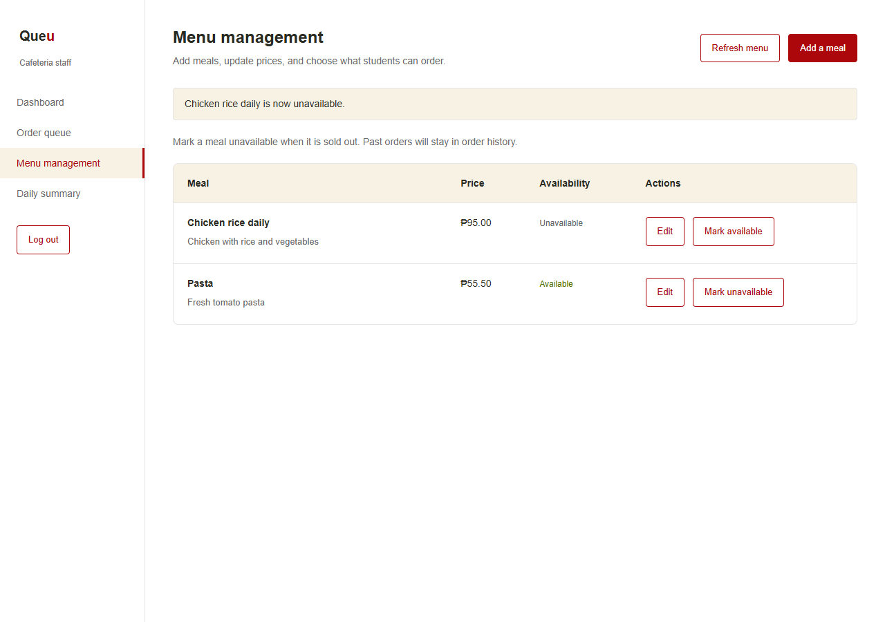
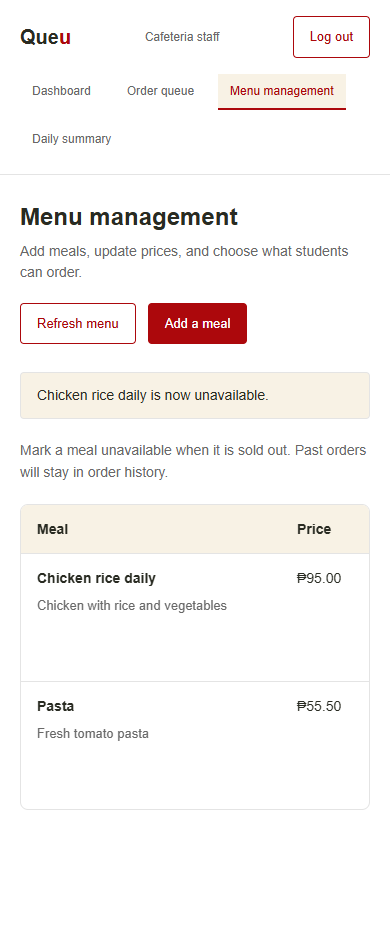
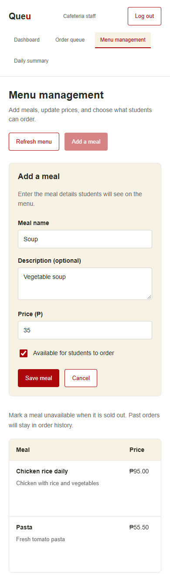

# Staff menu management

Implements [Issue #57](https://github.com/GONG4o4/campus-cafeteria-system/issues/57) at `/staff/menu`, using the existing cafeteria staff navigation, red/cream/white styling, shared buttons, loading messages, and alerts.

## What staff can do

- View current meals in a table with their descriptions, prices, and availability.
- Add a meal with a required name and price, an optional description, and availability.
- Edit a meal's name, description, price, and availability.
- Mark meals unavailable or available without deleting them.
- Refresh the list and retry failed loads or saves.

The table scrolls inside its container on small screens. The page and form fit the screen at 320px, 390px, 768px, and desktop sizes. New styles use ordinary widths, Flexbox, and media queries, with no `:root`, `grid-template-columns`, or `min()`/`calc()` width formulas.

## Existing backend integration

No new backend routes or schema changes are needed. The page uses these existing routes:

| Method | Path | Purpose | Access |
| --- | --- | --- | --- |
| GET | `/api/menu` | List all meals, including unavailable meals. | Public |
| POST | `/api/menu` | Add a meal. | JWT with `cafeteria_staff` role |
| PUT | `/api/menu/:id` | Update meal details, price, or availability. | JWT with `cafeteria_staff` role |

Writes send `name`, `description`, `price`, and `is_available`, plus the bearer token. They do not send a user ID or role. Availability uses the existing full-item PUT endpoint. This page does not call DELETE.

The backend already validates these fields and rejects student, general staff, admin, and unauthenticated mutation requests. Its authorization remains unchanged; frontend role checks do not replace backend authorization.

## Validation and save behavior

Names are trimmed, required, and limited to 100 characters. Prices must be between 0 and 99,999,999.99, with at most two decimal places. Negative, blank, non-numeric, scientific-notation, and oversized prices are rejected. Zero is accepted by the existing API. Availability is a boolean.

Client validation shows errors beside the fields. The backend repeats validation before issuing SQL. Form input remains visible after rejected saves. Buttons are disabled during a save, and a ref prevents duplicate submits before React updates the screen.

Only a confirmed successful API response updates the table. Connection failures, unreadable responses, or incomplete receipts show an uncertain-save message and block another save until a successful menu refresh, so the user can check whether the first attempt saved. Saves are not automatically retried.

## Student menu and historical orders

Successful changes notify other tabs using a timestamp in local storage and notify the current window with a `menu-updated` event. The student menu also refreshes when its window regains focus or becomes visible, and includes a manual Refresh menu button. Each refresh reads the existing backend menu endpoint. Unavailable meals remain visible with disabled add-to-cart controls.

Menu updates do not alter `orders.total_amount`, `order_items.unit_price`, or `order_items.subtotal`. Saved order prices and totals remain independent of the current menu price. A real PostgreSQL test placed a two-item order at 75 each, changed the current meal price, and marked the meal unavailable; the saved unit price remained 75 and the order total remained 150. Meal names in existing history still follow the existing backend join to the current menu name.

## Testing

Run `npm test` in `backend`, then `npm test`, `npm run lint`, and `npm run build` in `frontend`.

- All 86 backend tests passed, including create/update boundary prices, rejected names/prices/types, role enforcement, availability, and database errors.
- All 12 frontend tests passed, including validation, exact write payloads, auth errors, cancelled reads, uncertain saves, and menu notifications.
- Browser tests exercised real staff login, add/edit forms, duplicate submits, both availability directions, a second menu tab automatically refreshing, loading/empty/error states, failed saves with retained input, uncertain-save recovery, responsive layouts, and logout.
- Real API/database checks used a temporary schema inside the separate `campus_cafeteria_dev` database. All schema and test data were rolled back. The original database was never connected to, and the backend `.env` was unchanged.
- No uncaught browser JavaScript errors or page-level horizontal overflow were found.

Local live login still depends on a correctly configured database and JWT secret. This change does not switch the user's restored configuration back to the separate test database.

## Screenshots

